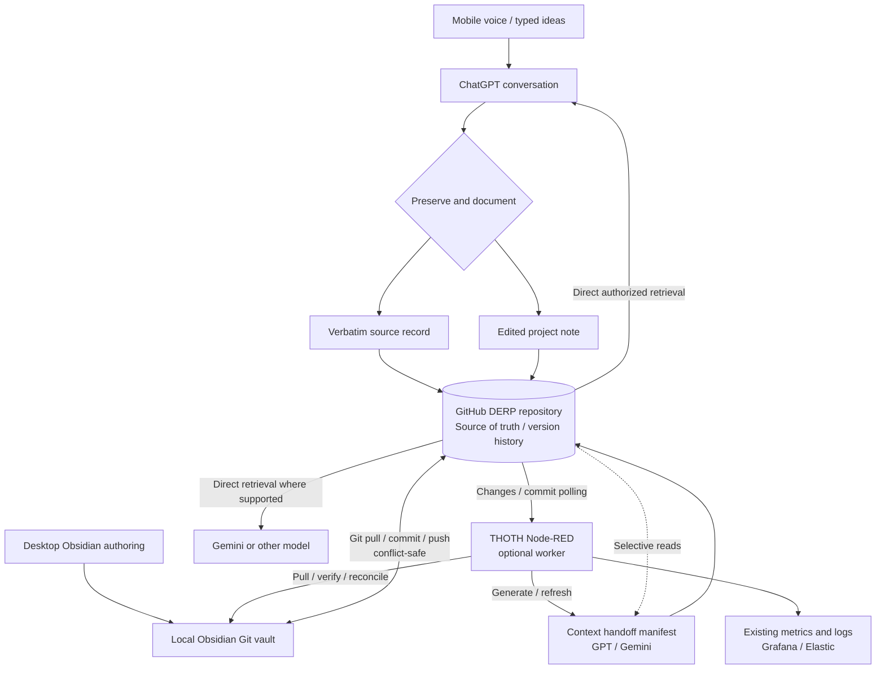

# DERP — Direct GitHub Integration and Delegated Handoff Architecture

- Date: 2026-11-22 (America/Detroit)
- Status: Architecture brainstorm / proposed, not deployed
- Parent: [Delegated Etheral Remote Protocol](./README.md)
- Source: User's remote brainstorming discussion; interpretations and recommendations distinguished from confirmed capabilities
- Design objective: Capture ideas from ChatGPT or other clients when away from home, preserve verbatim source, and reconcile through GitHub with Obsidian and multiple AI models.

## Design decision — direct first, worker second

Use **ChatGPT's connected GitHub integration** for direct, authorized repository reads, file creation and updates. A GitHub connector write was already demonstrated in the parent project. This avoids treating an always-on Node-RED worker as a requirement for capturing remote notes.

Introduce **Node-RED on THOTH** only for unattended operations: local vault synchronization, Git commit observation, context manifest/snapshot generation, telemetry and optional Gemini handoff. No claim that a remote ChatGPT or Gemini session automatically observes new commits; each client must explicitly retrieve context or use a tested supported refresh path.

## Logical architecture



**Diagram scope:** Logical and proposed. It does not assert a live Gemini connector, an existing Node-RED watcher, or bidirectional automatic synchronization.

## Operational paths

### Path A — No worker (minimum viable)

1. User dictates an idea on phone using ChatGPT.
2. ChatGPT saves an **exactly preserved source transcript** in a new append-only Markdown record.
3. ChatGPT writes a separate **edited interpretation or research note** with source linkage and corrections.
4. GitHub records commits; a future session retrieves the relevant records on demand.
5. Obsidian's existing Git workflow pulls the changes when synchronized. No unattended mobile/desktop sync is promised.

### Path B — Optional Node-RED service

1. Watch GitHub repository commit SHA, using outbound polling to avoid inbound firewall dependencies.
2. Compare last processed and latest commits; fetch changes only.
3. Serialize changes into a machine-readable context manifest and per-project summaries.
4. Publish handoffs to GitHub; optionally update a local Obsidian working tree after checking for uncommitted changes and divergence.
5. Export task state and errors to existing THOTH observability tools.
6. Make execution idempotent and serialize writers; record successful commit, sync state, failures, and retries.

### Path C — Multi-model handoff experiment

1. ChatGPT commits a verbatim record plus edited note.
2. A generated `context/manifest.json` indexes the commit, project, source references and latest verified findings.
3. A later Gemini session retrieves those records using a separately verified integration or pasted file; do not claim direct access without testing.
4. Compare Gemini reconstruction against original source; record omissions, contradictions and provenance failures.
5. Reverse direction and test the same with ChatGPT.

## Proposed repo layout

```text
Projects/Delegated-Etheral-Remote-Protocol/
  README.md
  Verbatim-Source.md
  Architecture-Brainstorm.md
  Experiments/
    remote-capture-001.md
  Context/
    manifest.json
    chatgpt-current.md
    gemini-current.md
```

The `Experiments/` and `Context/` paths are **proposed**; they should not be treated as existing until created.

## Design invariants

- **One source of truth:** GitHub commit history and source records; generated model-specific context files are disposable derivatives.
- **Two layers of language:** Original speech/text kept verbatim; official documentation edited for readability without silently changing intent.
- **Provenance:** Capture event time, collection time, source/session identifier where available, commit SHA, and later corrections.
- **No mistaken identities:** Distinguish a retrieved file from a verified match. The previously incorrect chicken-photo association is a regression-test example.
- **No blind merge:** Refuse automatic force-push, reset or overwrite when local and remote histories conflict. Report conflicts for reconciliation.
- **No unconditional binary upload:** Keep original images/video local or in economical storage; catalog hashes, metadata and limited previews.
- **No unnecessary cadence:** Ten-minute autosave is deferred. Prefer direct writes and events before adding periodic polling.
- **Avoid circular service dependencies:** Service boot/recovery stays outside Node-RED where needed.

## Open experiments

- Can a mobile ChatGPT conversation commit original wording and an edited document directly to GitHub?
- Does a fresh desktop ChatGPT conversation retrieve the precise source and commit without unrelated context?
- Can Gemini retrieve the same files without manually pasting them, using an actual authorized connection?
- Can THOTH's local Obsidian Git vault pull changes safely while local edits are outstanding?
- Is a manifest enough, or do we need a lightweight retrieval index/search service?
- What event or polling interval is actually necessary for the unattended worker, if one is added?

## Current state

- **Confirmed:** GitHub connector access in ChatGPT can read/write the DERP repository and report commit SHAs.
- **Confirmed:** DERP parent project files already committed.
- **Not verified:** Gemini direct GitHub write/read integration, THOTH watcher, local Obsidian sync automation, autonomous cross-model context delivery.
- **Deferred:** 10-minute autosave and cron/systemd migration.
