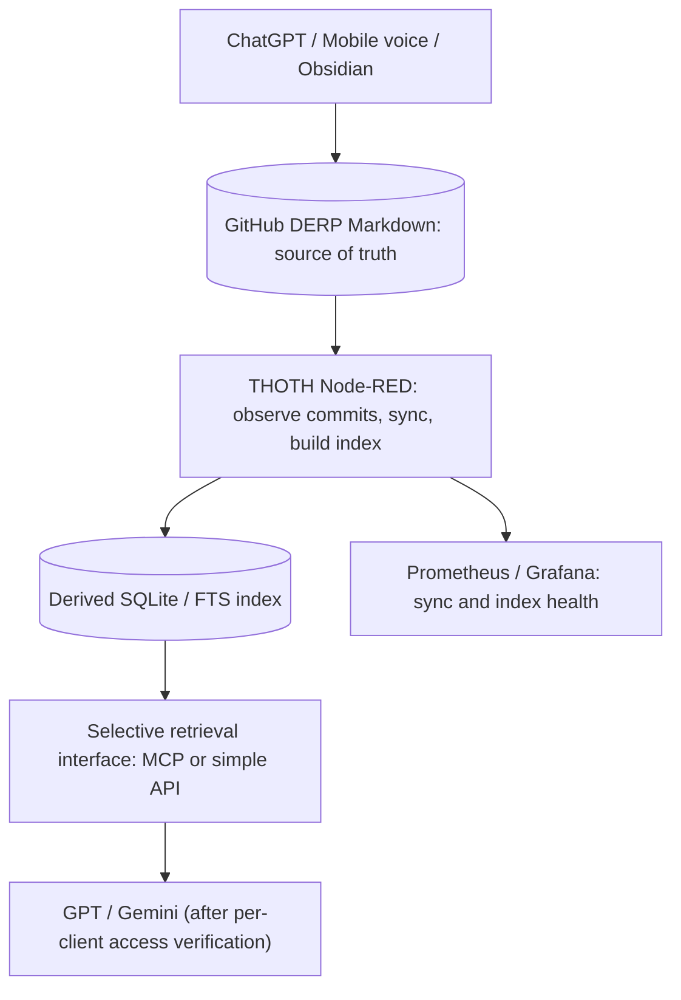

# DERP — Framework Review and Adoption Plan

**Date:** 2026-11-22  
**Status:** Research evaluation only, not deployed  
**Sources:** Live DERP design discussion; current upstream documentation cited below.

## Current foundation verified from our project notes

- GitHub repository and Obsidian Markdown are the authoritative versioned source.
- ChatGPT can directly create, read and update repository files through authorized access.
- Proposed THOTH Node-RED worker: commit observation, sync, context generation, status to Prometheus/Grafana.
- Source utterances must remain verbatim; edited documentation stays separate.
- Provenance and source links are required for interpretations; do not confuse successful file retrieval with correctly matched evidence.
- Ten-minute autosave, automatic Gemini bridge, and Git-health dashboards are proposed/deferred, not confirmed deployed.

## Evaluated frameworks

| Framework | Relevant capability | DERP use | Position |
| --- | --- | --- | --- |
| Basic Memory | Markdown, Obsidian, MCP, knowledge graph, SQLite, hybrid search | Files and relations without replacing Obsidian | First isolated pilot |
| ai-memory | Git-versioned Markdown, derived SQLite, per-project memory, agent handoffs, lifecycle capture | Copy handoff, scope and idempotent ingest patterns | Study / compare before adopting |
| Graphiti | Temporal fact validity, provenance episodes, relationships, historical queries | Temporal DERP reconciliation | Adopt schema ideas; defer deployment |
| Khoj | Personal AI interface, multi-client Obsidian/web/mobile access | UX inspiration | Defer separate assistant deployment |
| Mem0 | Memory extraction, retrieval and personalization | Optional derived summarization | Defer unless demonstrated need |
| MCP Memory | Minimal entity/relation/observation server | API concepts | Reference only; whole-file updates undesirable at scale |

## Recommended minimal pipeline



## First cleanup: common frontmatter

Every derived evidence note should carry an ID, system/subsystem, record type, event/capture and collection times, source locator, assertion/verification state, associated commit, relationships and supersession. Source files remain immutable and separate from editorial interpretations. Use stable IDs rather than filenames as canonical identity.

Sample:
```yaml
id: derp-evidence-0001
system: THOTH
subsystem: node-red
record_type: observation
observed_at: 2026-11-22
recorded_at: 2026-11-22
source: screenshot
verification: visually_observed
supersedes: null
related: [frigate, blue-iris, elasticsearch]
```

## Phased plan

1. **Schema:** Implement record IDs, source/evidence links, correction chain, temporal metadata.
2. **Index proof-of-concept:** Read a representative portion of current vault into SQLite FTS5, retain citations to source path and Git commit. Compare an isolated Basic Memory pilot with a small custom index; choose one, not both as production writers.
3. **Handoff test:** Model session handoff records after ai-memory; preserve last verified state, unresolved questions, relevant paths, and commit SHAs.
4. **THOTH orchestration:** Read-only commit watcher, index refresh, divergence checks, successful handoff metrics; verify before enabling write reconciliation.
5. **Temporal test:** Answer 'what was true at time T?' using provenance/supersession. Deploy Graphiti only if benchmarked graph complexity justifies operational costs.
6. **Interface:** Expose bounded retrieval through an MCP endpoint or simple API; add GraphQL only if concrete consumer queries warrant it.

## Acceptance tests

- Source transcript preserved exactly and never overwritten by an editorial version.
- Search result cites original file plus source commit.
- Fresh session restores one system's outline without unrelated systems.
- Contradiction history is recoverable at any prior time.
- A deliberately wrong image match is rejected or labeled unverified.
- Generated indexes can be deleted and rebuilt from Git evidence.
- Sync conflicts fail visibly and never auto-force-push.
- Measure retrieval latency, recall, false-source association, index lag and storage footprint.

## Reading

- https://github.com/basicmachines-co/basic-memory
- https://github.com/akitaonrails/ai-memory/blob/main/docs/cookbook.md
- https://github.com/getzep/graphiti
- https://github.com/khoj-ai/khoj
- https://github.com/mem0ai/mem0
- https://github.com/modelcontextprotocol/servers/tree/main/src/memory

**Decision:** Preserve current Git-backed architecture. Prioritize schema + one isolated index/handoff pilot. No framework installation authorized by this research note.
