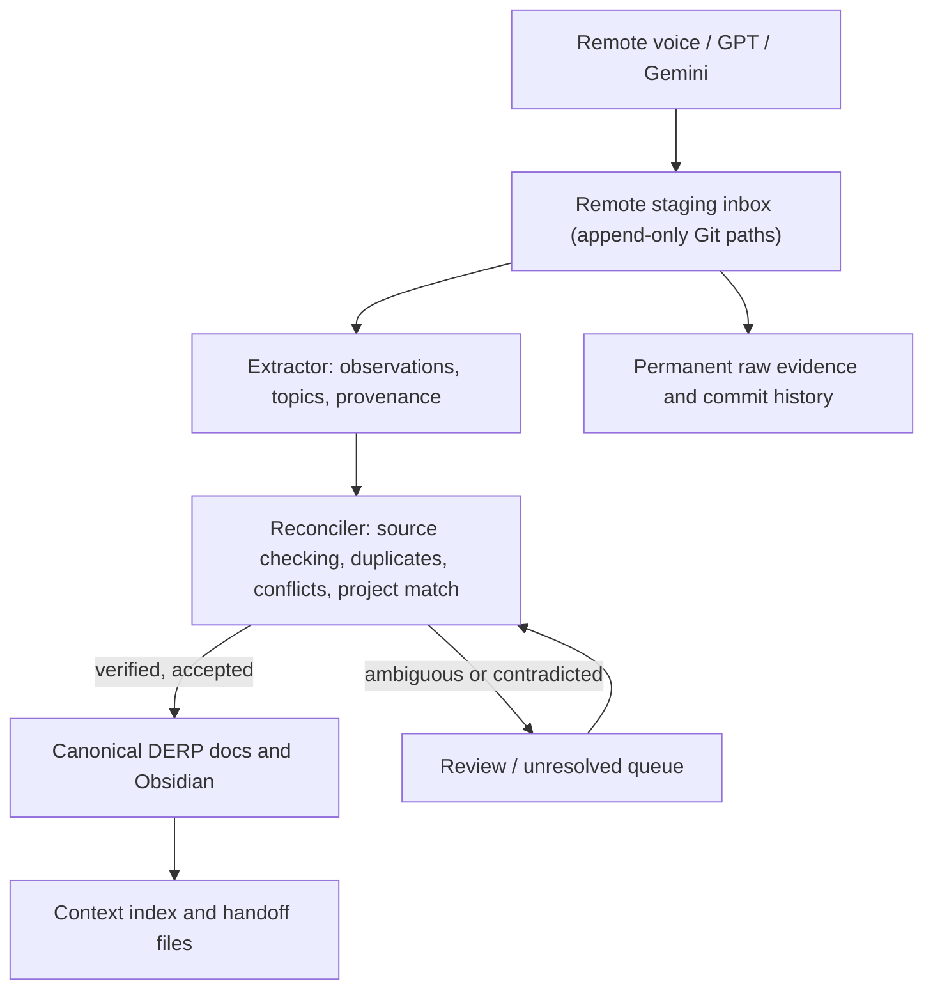

# DERP — Remote Capture and Repository-Aware Routing

- Date: 2026-11-22 (America/Detroit)
- Status: Proposed implementation design, not deployed
- Parent: [Delegated Etheral Remote Protocol](./README.md)
- Sources: Working session; [Framework Review](./Framework-Review-and-Adoption-Plan.md), [Architecture](./Architecture-Brainstorm.md)
- User goal: Allow remote/mobile voice brainstorming while keeping a rapidly growing Git-backed Obsidian vault organized without generating redundant notes.

## Principle

**Capture first, classify second, reconcile third.** Preserve verbatim source even if classification or network access fails. Interpretations are versioned derivatives, never replacements for original evidence.

## Minimal implementation: no mandatory worker

1. User speaks/types in a ChatGPT mobile or desktop conversation.
2. Upon explicit archive/save instruction or established in-session saving workflow, ChatGPT writes a new **append-only capture record** to GitHub using the authorized connector.
3. Before writing a polished note, retrieve a compact repository **project catalog** and search for matching topic IDs, related records and current documentation.
4. Route the capture to an existing project if sufficiently supported; otherwise classify it as `unassigned` rather than invent a match.
5. Write a separate **proposed editorial update** describing a small amendment to an existing note, a new decision, a correction, or a genuinely new project.
6. Link original capture ID, relevant evidence refs, and exact resulting commit SHA when known. Verify the actual GitHub write; never imply automatic chat saving.

This means mobile internet access plus a working GitHub connection is sufficient for phase one. It does not depend on THOTH running.

## Repository roles

```text
DERP/
  Inbox/
    2026/11/22/<capture-id>.md         # raw, append-only
  Projects/
    <project>/
      README.md                        # edited, curated project description
      Decisions/                       # decisions linked to raw evidence
      Research/                        # new notes only when genuinely distinct
  Index/
    projects.yaml                      # canonical IDs, aliases, paths, status
    relationships.jsonl                # derived links (rebuildable)
  Context/
    handoffs/<project>.md              # generated, disposable, last verified refs
  Experiments/
    retrieval/                         # mistakes, confirmation and benchmark results
```

All paths above are proposed additions and are not asserted to exist.

## Routing policy

Classify each new utterance as:
- `source`: always preserve verbatim
- `existing_topic_update`: link and propose minimal addition to a relevant canonical file
- `decision`: record what changed and why, with source references
- `correction`: preserve previous claim and append superseding evidence
- `new_project`: create a project only when truly distinct
- `unassigned`: store without guessing when routing confidence is low

Prefer one canonical project overview, separate immutable captures and small decision records. Don't produce multiple summaries of the same discussion.

## Two operational modes

### Interactive (no worker required)

ChatGPT reads GitHub index and relevant files, captures source to a unique new path, optionally edits one canonical doc using the current blob SHA, confirms resulting commit. Ask before publishing sensitive sources to a public repository.

### Deferred/orchestrated (THOTH Node-RED optional)

A single-writer Node-RED flow monitors GitHub's newest processed SHA, pulls newly committed captures, rebuilds SQLite FTS5 / relationship indexes, queues proposed edits/duplicates for review, and exports context manifests and Prometheus metrics. Use read-only/observation mode first. No blind force-push or merge.

**Note:** Node-RED cannot autonomously read arbitrary ChatGPT voice sessions unless those sessions are explicitly exported, committed, or exposed through an authorized supported integration. The GitHub commit is the practical handoff event.

## Minimal metadata fields

```yaml
id: derp-capture-20261122-0001
project_id: delegated-etheral-remote-protocol
record_type: source
captured_at: null
captured_at_source: unverified
recorded_at: "2026-11-22"
source_surface: chatgpt
source_session: null
verbatim: true
status: captured
related: []
```

Do not invent precise timestamps, session identifiers, evidence hashes or commit IDs when unavailable. Commit SHA is better captured by a separate manifest or write receipt, not pre-filled inside the same commit's content.

## First build milestone

**Test A:** From phone, submit idea with the command `DERP capture`. Preserve the exact statement in a unique Inbox Markdown file and add a separate editorial classification linked to it. Verify file/commit in GitHub.

**Test B:** Start fresh desktop conversation: query a high-level project index, locate the capture and its edited interpretation, reconstruct the discussion, and report source provenance.

**Test C:** Submit a near-duplicate thought. Confirm it is connected to the prior topic instead of creating a second project document.

**Test D:** Submit conflicting information. Confirm it is flagged for reconciliation rather than silently changing canonical project state.

**Test E:** Turn off THOTH. Confirm remote GitHub capture still works while the local worker is unavailable.

## Suggested telemetry, once deployed

- `derp_capture_ingest_success_total`
- `derp_capture_ingest_failure_total`
- `derp_unclassified_capture_count`
- `derp_index_last_success_timestamp_seconds`
- `derp_handoff_age_seconds`
- `derp_reconciliation_queue_depth`

## Key choices to preserve

- GitHub remains authoritative for versioned project knowledge.
- Original words and polished documentation are separately retained.
- Existing notes should be amended or linked before new files are created.
- A derived SQLite/FTS5 index and GraphQL/MCP endpoints are future optimization, not prerequisites.
- Node-RED is an asynchronous maintenance layer, never a hard dependency for mobile capture.
- The ten-minute autosave remains on the back burner.

## Revision: remote staging bucket and reconciliation gate (2026-11-22)

**Design preference:** Remote capture is a distinct staging area, *not* a direct writer to canonical project files. This supersedes the earlier proposed immediate editorial update to canonical documentation. No worker or merge is claimed to exist yet.

### Proposed flow



### Storage choice

The initial "bucket" can simply be an **isolated `Remote-Staging/` prefix in the same GitHub repository**, to minimize permissions, services, and sync complexity. Use a dedicated Git branch or repository only if we establish a real need for stricter publication boundaries, access controls, or independent retention. A GitHub prefix is logical organization, not an access-control boundary: for sensitive sources, use a private repository or appropriately controlled storage.

Suggested paths:

```text
Remote-Staging/
  incoming/<YYYY-MM-DD>/<unique-id>.md
  extracted/<unique-id>.json
  receipts/<unique-id>.json
  review/<unique-id>.md
Projects/<project>/...                    # curated knowledge, separate from raw
```

Treat raw files as immutable after capture; revisions are linked follow-ups. `extracted`, `receipts`, and `review` are prospective, not created by this design note.

### State machine

`captured → extracted → matched → verified → merged`, with `held`, `rejected`, and `superseded` states. "Matched" means candidate topic association only, not validated truth. "Verified" must identify the evidence and decision. A rejected interpretation never deletes source. All actions should be idempotent keyed by capture ID and source commit, with receipts that record the destination update commit only after confirmed success.

### Safeguards

- Remote ChatGPT should write new staging records only. A failed or unreachable THOTH never blocks capture.
- Node-RED detects staging commits, builds suggested changes, tracks review queue and exposes health telemetry; it does **not** automatically approve claims.
- Compare against canonical documents by stable ID, not just name similarity; flag contradictions and duplicate evidence.
- Canonical changes occur only after the chosen reconciliation/approval policy. Start with human review.
- Keep a permanent link from canonical notes to the original capture ID and source commit.
- Guard against generated files triggering infinite Git watcher loops by path filtering and idempotent processing.
- Preserve Git conflict safety and separation of source records from derived material.
