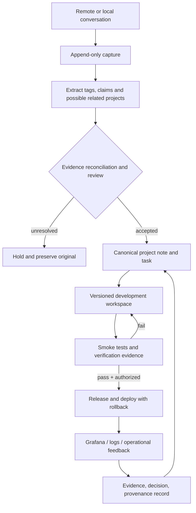

# DERP — Workspace Discipline and Engineering Lifecycle

**Status:** Proposed for review; not implemented  
**Recorded:** 2026-11-22 (America/Detroit)  
**Scope:** DERP remote capture, local Git/Obsidian, THOTH/Node-RED, future automation workers  
**Owner of decisions:** Human operator; Git records are authoritative evidence, while AI-generated classifications remain proposals

## Executive decision

Adopt **workspace discipline before further autonomous execution**. Preserve high-velocity brainstorming, but consistently separate source evidence, proposed interpretations, development, testing, releases and production state. Do **not** perform a broad migration merely to comply with a new template.

**Principle:** Discover and reconcile real workspaces before restructuring anything. Preserve known-good working versions and rollback references.

## Observed foundation versus proposed work

**Established in connected project records:** a GitHub-backed DERP repository, editable Markdown/Obsidian-oriented documentation, authorized ChatGPT GitHub reads/writes, and versioned architecture/research notes.

**Known from project discussions but not re-audited in this note:** THOTH runs Node-RED and a telemetry stack; Blue Iris/Frigate and other home-lab services exist. Their *current deployment configurations and paths* require direct inspection before automation.

**Not yet confirmed implemented:** automated remote staging → canonical reconciliation; Node-RED Git watcher; DERP idea parser, bootstrap, project registry, GraphQL/MCP API, autonomous engineering workers, or a DERP Grafana dashboard.

## Non-negotiable workspace rules

1. **One canonical identity per project:** stable `project_id`, repository URL, canonical overview path and alias registry. Cross-project relationships are links, not duplicated project copies.
2. **Separate lifecycle zones:** captured source → extracted claims → reconciled/approved knowledge → development → tested release → deployed version → observed evidence. These are states, not necessarily distinct servers.
3. **Immutable provenance:** original transcript, images/hashes and execution observations never silently overwritten by polished text. Corrections refer to prior records and preserve event/collection timestamps.
4. **Known-good preservation:** promote via commits/tags/releases, keep previous artifact and deployment manifest, and document rollback procedure; no destructive in-place replacement by default.
5. **No blind automation:** failed tests, ambiguous classifications, dirty Git trees and divergence generate held/review states, not force-pushes or automatic canonical edits.
6. **No speculative state promotion:** proposals, observations, verified outcomes and live production are distinct; success assertions require reproducible evidence.
7. **No proliferation for its own sake:** before creating a new project document, check canonical project registry, related notes, duplications and existing owners. Prefer references or targeted amendments.
8. **No production execution from unverified remote inputs:** commit-pinned source, hash checks, dependency manifests, isolated builds, tests and authorized deployment policies before promoting reusable workers.

## Proposed organizational model

```text
DERP repository (proposed conventions; paths are not claimed to exist)
├── Remote-Staging/
│   ├── incoming/                 # append-only raw remote captures
│   ├── extracted/                # machine-derived candidates, non-authoritative
│   ├── review/                   # ambiguous/duplicate/conflicting claims
│   └── receipts/                 # merge and processing evidence
├── Index/
│   └── projects.yaml             # stable project IDs and canonical paths
├── Projects/
│   └── <project-id>/
│       ├── README.md             # canonical project overview
│       ├── manifest.yaml         # locations, owners, runtimes, states
│       ├── docs/                 # design and instructions
│       ├── src/                  # reusable code
│       ├── tests/                # repeatable verification
│       ├── config/               # examples/templates; secrets excluded
│       ├── deploy/               # deployment and rollback definitions
│       ├── evidence/             # logs, source references, result metadata
│       └── releases/             # promoted artifact references
└── Context/
    └── handoffs/                 # generated, rebuildable context manifests
```

**Important:** This is a *reference structure*, not a mandatory immediate refactor. Raw binaries and machine-local runtime data do not necessarily belong in Git. Document where they live using manifest references and hashes.

### Storage and permissions

- **GitHub canonical DERP:** versioned authoritative records and approved project content.
- **Remote staging:** logically isolated from canonical writes; a **separate private repository** is preferable when enforceable per-repository writer privileges are needed. A folder prefix inside one repository is *not* a write-permission boundary.
- **Local host volumes:** runtime data, caches, environments, large models, and builds reside on explicitly designated local paths.
- **Existing INFINITY convention:** avoid placing CPAI/YOLO26 project files, models, virtual environments, artifacts and tests on C:; use approved non-system volumes such as H: or G:. This is a project-specific constraint, not a global rule for all hosts.
- **Deployment permissions:** remote capture clients should not hold production deploy authority.

## Proposed manifest fields

```yaml
schema_version: 1
project_id: delegated-etheral-remote-protocol
title: Delegated Etheral Remote Protocol
status: proposed
canonical_overview: Projects/Delegated-Etheral-Remote-Protocol/README.md
repository: craigmcdaniel/Derived-Entropic-Rememory-Protocol
aliases: [DERP-remote]
source_of_truth: git
runtime_hosts: []
development_paths: []
test_command: null
deployment_target: null
release_reference: null
rollback_reference: null
related_projects: []
last_verified_at: null
```

`null` is intentional. An unverified path, host, command, or deployment must not be guessed.

## Workflow: one task, end to end



The diagram is a **target process**, not a claim that automation is in place.

## Worker's workspace contract (future)

Each worker task receives:
- task identity, intent, approved scope and human authorization;
- canonical repo, pinned commit, project manifest and bounded related evidence;
- working directory, target host, allowed operations, and artifact output directory;
- test plan and objective pass/fail criteria;
- deployment policy and rollback reference, if deployment is permitted;
- evidence destination and status-report schema.

Each worker produces: changed files/commit, build logs, test results, deployed artifact reference if applicable, errors/holds, and provenance links. No worker may silently revise original capture evidence to make its result appear successful.

## First milestone — inventory, don't migrate

1. Identify the currently active Git repositories and actual project paths through an explicit read-only inventory.
2. Record one pilot project manifest with confirmed locations; start with this DERP remote project.
3. Identify duplicate/obsolete documents without deleting or moving anything.
4. Create a small, versioned status vocabulary: `proposed`, `active`, `testing`, `verified`, `deployed`, `deprecated`, `archived`.
5. Run one controlled remote staging → classification → review → accepted canonical update test, preserving receipt and original wording.
6. Only then connect Node-RED monitoring and optional automation.

## Acceptance criteria for review

- A fresh worker can identify a project's canonical overview and exact code revision *without guessing*.
- A newly captured remote idea cannot directly overwrite canonical notes.
- A duplicate idea links to an existing project instead of multiplying copies.
- A failed experiment or obsolete configuration remains discoverable, labeled by its historical state.
- The known-good implementation can be recovered with a documented rollback reference.
- Unverified assertions remain unverified, including machine-generated classifications.
- Changes to repository state and deployment state are both traceable to evidence.

## Review decisions still open

1. Separate GitHub staging repository versus same-repo prefix for early tests; enforceable permissions favor a separate repository.
2. Which local Git/Obsidian vault is the canonical working clone? Must verify on host.
3. Which code/manifest directories can be standardized without relocating existing working projects?
4. What level of human approval is required for each promotion boundary?
5. Which worker should own index refresh and which should own deployment, if they are separate?
6. How should large image/video artifacts be stored and referenced?

## Source documents

- [Delegated Etheral Remote Protocol README](./README.md)
- [Remote Capture and Repository-Aware Routing](./Remote-Capture-and-Repository-Routing.md)
- [Framework Review and Adoption Plan](./Framework-Review-and-Adoption-Plan.md)
- [Architecture Brainstorm](./Architecture-Brainstorm.md)
- [Git Health and Knowledge-System Observability](./Git-Health-Observability.md)

**Review note:** No current system configuration was changed, no worker deployed, and no working directory reorganized by this document.
