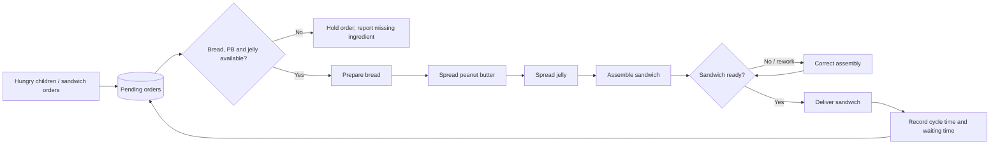
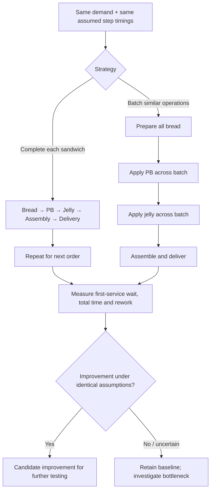
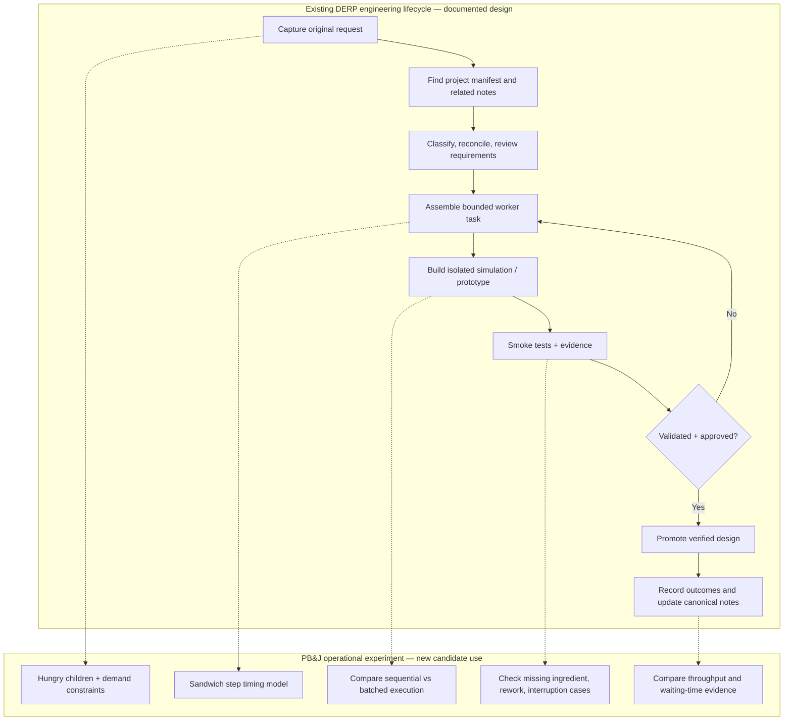
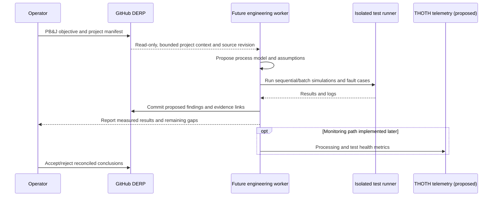

# PB&J Scaling Experiment — Process Maps and DERP Reuse

**Date:** 2026-11-22 (America/Detroit)  
**Status:** Design visualizations for review; no physical build, simulation, baseline timing or deployment confirmed.  
**Project:** [Peanut Butter and Jelly Machine](./README.md)  
**Manifest:** [manifest.yaml](./manifest.yaml)

## Intent

The current project requirement is **PB&J scaling efficacy when watched by hungry children**. Explore what improves throughput, time-to-first-sandwich and waiting time under demand/interruptions. This is an *operations-research model*, not a mandate to construct a robot.

All charts below are **Mermaid diagrams designed to render in GitHub/Obsidian and remain editable text**. The sequence diagrams and process graphs represent **proposed workflows**; no timing, equipment, completed automation, or observed performance is implied.

## Diagram A — Current candidate sandwich process and queue

### Operational observations versus unknowns

- **Known requirement:** Scale PB&J output for hungry children observing/waiting.
- **Unverified assumptions:** Preparation is sequential; there are separate PB and jelly steps; interruptions may affect work.
- **Unknown:** Number of children, time per step, overlap between steps, ingredient quantities, defect rate, interruptions and real bottleneck.
- **Output metrics to collect:** `time_to_first_sandwich`, `total_batch_time`, `orders_completed_per_minute`, `per_order_wait`, `rework_count`.

## Diagram B — Two candidate production strategies (not results)

**Experimental insight:** Batching can improve total throughput while *delaying the first completed sandwich*. Evaluate fairness/latency and throughput separately; don't label a strategy superior before measuring.

## Diagram C — Cross-project reuse: the DERP implementation pipeline applied to PB&J

**Source mapping:** This pipeline is drawn from [Workspace Discipline and Engineering Lifecycle](../Delegated-Etheral-Remote-Protocol/Workspace-Discipline-and-Engineering-Lifecycle.md), [Remote Capture and Repository-Aware Routing](../Delegated-Etheral-Remote-Protocol/Remote-Capture-and-Repository-Routing.md), and [Direct GitHub Integration and Delegated Handoff Architecture](../Delegated-Etheral-Remote-Protocol/Architecture-Brainstorm.md). The PB&J steps are inferred for this project and are not reusable code found in the repository.

## Diagram D — DERP worker handoff and evidence return

**Not yet deployed:** The autonomous worker, isolated runner, Node-RED Git monitor, and DERP Grafana health dashboard are *future implementation components*. This sequence is a target contract, not an execution trace.

## Reusable documented patterns and evidence quality

| Pattern | Documentary source | Status | PB&J application |
| --- | --- | --- | --- |
| Stable project ID, manifest, canonical file | [Workspace Discipline](../Delegated-Etheral-Remote-Protocol/Workspace-Discipline-and-Engineering-Lifecycle.md) | Documented proposed standard; PB&J manifest created | Find and reopen the project without guessing |
| Staging, extraction, reconciliation, review | [Remote Routing](../Delegated-Etheral-Remote-Protocol/Remote-Capture-and-Repository-Routing.md) | Documented proposal | Keep new measurements from silently overwriting conclusions |
| Read/write GitHub and model handoff | [Architecture Brainstorm](../Delegated-Etheral-Remote-Protocol/Architecture-Brainstorm.md) | GitHub connector tested; automated handoff not proven | Provide task-specific context to another session |
| Indexing, MCP/API ideas | [Framework Review](../Delegated-Etheral-Remote-Protocol/Framework-Review-and-Adoption-Plan.md) | Research only | Discover future related process-control patterns |
| Test–release–observe loop | [Workspace Discipline](../Delegated-Etheral-Remote-Protocol/Workspace-Discipline-and-Engineering-Lifecycle.md) | Documented proposal | Evaluate and archive a verified improvement |

## First executable experiment — not yet written

A small deterministic Python simulation is sufficient:
- Inputs: order count, bread/PB/jelly/assembly times, selected scheduling policy, optional interruptions or rework.
- Scenarios: one-at-a-time and stage batching under identical inputs.
- Outputs: event records with completed order time, queue waiting time, overall completion time and failures.
- Tests: deterministic expected ordering, missing-ingredient stop, rework/interrupt behavior and reproducibility.
- Provenance: commit SHA, input parameters, run ID and measured versus simulated distinction.

No physical actuator hardware or safety controller is required for this first benchmark. If the project later becomes physical, use a suitable separate controller and real hardware/sanitation validation.

## Evidence boundary and next action

The PB&J project README and manifest were fetched as primary evidence. The four linked DERP design documents were fetched directly. **No existing functional PB&J automation software, timings, or physical equipment were found in the inspected documents.** A complete repository-wide absence claim is **not** warranted.

**Proposed next milestone:** commit a deterministic software-only simulation and test cases, then have a fresh conversation/worker reconstruct the plan from these linked files and verify source attribution.
