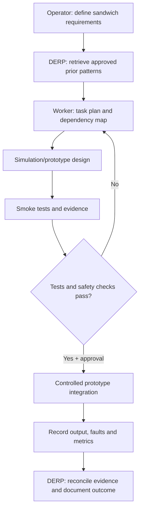

# Peanut Butter and Jelly Machine — DERP Reuse Experiment

**Recorded:** 2026-11-22 (America/Detroit)  
**Project ID:** `peanut-butter-and-jelly-machine`  
**Status:** Proposed / architectural thought experiment  
**Purpose:** Test whether DERP can discover documented reusable engineering patterns and assemble a defensible plan for a *new, unrelated project* without inventing existing code or machinery.  
**User prompt, preserved verbatim:** "and now a new test. We are going to create a project and abstractly look to see if we can find in our documentation a way forward with the newest ideas. \n\nSO go ahead and look back in the documentation to see how we can automate the peanut butter and jelly machine."

## Retrieval scope and evidence

The following existing DERP documents were fetched and inspected directly:

1. [Workspace Discipline and Engineering Lifecycle](../Delegated-Etheral-Remote-Protocol/Workspace-Discipline-and-Engineering-Lifecycle.md) — **documented proposal** for project identity, lifecycle stages, worker contract, tests, approval and rollback.
2. [Remote Capture and Repository-Aware Routing](../Delegated-Etheral-Remote-Protocol/Remote-Capture-and-Repository-Routing.md) — **documented proposal** for staging, classification, reconciliation, append-only capture and review states.
3. [Direct GitHub Integration and Delegated Handoff Architecture](../Delegated-Etheral-Remote-Protocol/Architecture-Brainstorm.md) — **documented and partly connector-tested** GitHub read/write, optional Node-RED watcher, context handoffs and metrics design.
4. [Framework Review and Adoption Plan](../Delegated-Etheral-Remote-Protocol/Framework-Review-and-Adoption-Plan.md) — **research proposal** for schema, SQLite indexing, model handoffs and graph concepts.

**Negative evidence limitation:** Repository file search for selected terms returned no indexed matches, even for terms present in known documents. Therefore a zero-result search is *not* evidence of absence. This experiment supports reuse of the four inspected design documents only; no existing PB&J hardware, code, or manufacturing process was verified.

## Abstract project objective

Explore an automated process that accepts bread, peanut butter, and jelly, performs preparation and assembly, and produces a consistent sandwich. This is a conceptual design objective, **not** a physical robot currently built or a defined bill of materials.

## Architecture skeleton



### Functional subsystems — **new engineering inferences, not found implementations**

| Proposed subsystem | Function | Early test |
| --- | --- | --- |
| Ingredient provisioning | Track presence and quantity of bread/spreads | Detect missing ingredient and stop |
| Bread handling | Present and align two slices | Detect misalignment/jam |
| Peanut-butter applicator | Meter and spread target portion | Repeatability on test surface |
| Jelly applicator | Meter and spread target portion | Repeatability and leakage check |
| Sandwich assembly | Bring slices together and present output | Consistent alignment |
| Supervisory controller | Sequence steps and enforce interlocks | State-machine simulation and fault injection |
| Health and event logging | Produce cycle evidence and failure telemetry | Capture timestamps, step outcomes and faults |

These conceptual components would require hardware selection, mechanical design, ingredient-contact sanitation, allergy/cross-contact procedures, guarding, cleaning, and controls engineering before real construction. No actuator/power specification is asserted.

## What we can reuse from documented DERP patterns

- **Project manifest:** stable ID, approved repository, revision, state, evidence and pending decisions — workspace discipline document.
- **Task handoff:** bounded task context, assumptions, allowed operations, test plan, artifact references and outcome receipts — worker-contract proposal.
- **Versioned code retrieval:** commit-pinned source/manifest and hash checks before execution — workspace discipline proposal, not existing live bootstrap.
- **Event-driven orchestration:** THOTH Node-RED as *candidate* sequencing for software orchestration, not inherently a real-time safety controller — remote integration architecture proposal.
- **Testing:** staged simulations and smoke-test evidence linked to the exact code revision — lifecycle proposal.
- **Observability:** proposed Grafana and metrics to measure cycles, faults, and processing state — integration/observability concepts.
- **Reconciliation:** carry observed failures and corrections into canonical project docs while preserving raw original source — remote routing design.

## Candidate software architecture (proposed)

```text
DERP Git repo           canonical project docs, worker manifests, code, tests
    |
    v
Engineering worker      retrieve task-specific patterns, assemble simulation/code
    |
    v
Isolated test runner    validate state machine and mocked I/O
    |
    v
Prototype controller    physical sequencing if/when hardware selected
    |
    v
Telemetry/reporting     structured results → eventual Node-RED / Grafana
    |
    v
DERP reconciliation     verify, link source evidence, promote known-good version
```

**Boundary:** Node-RED could coordinate work orders, logging and monitoring, but a physical machine's timing-critical actuator control and safety interlocks require a suitable controller and independent safety design. Do not infer that Node-RED/GitHub integration can safely drive food-contact machinery directly.

## First test case — make the platform do useful work without hardware

1. Create this new project and manifest (current experiment).
2. Build a mock sandwich process as a deterministic state machine with `idle → ingredient-check → dispense-pb → dispense-jelly → assemble → complete`, and `fault` transitions.
3. Define acceptance criteria for successful simulated cycles and failure handling.
4. Produce test output (JSON), evidence references, and a result receipt.
5. Ask a new worker/session to retrieve only this project plus the linked DERP source docs, reproduce the simulation plan, and explain all missing prerequisites.
6. Measure whether this reuse reduced manual reconstruction without hallucinating existing machinery.

## Unresolved decisions

- Is this ultimately an illustrative software-only benchmark, or a physical food-making device?
- What does success mean: one sandwich, throughput, consistency, cost, sanitary compliance, etc.?
- Which hardware platform, sensors, actuators, and controls are appropriate? **Unknown**.
- Where should a prototype be built and tested? **Unknown**.
- Which existing scripts can be reused directly? **Not established** by reviewed records.

## Assessment

**Result:** DERP can already supply a coherent *project initiation and evidence-handling framework* for an unrelated idea. A working physical PB&J automation design, generated parser, runtime bootstrap, existing working module matches, and autonomous deployment are **not** yet demonstrated.

**Next milestone:** a zero-hardware state-machine simulation with versioned tests and results, before any real actuator integration.

## Scope correction — hungry children and scaling efficacy (2026-11-22)

**Verbatim user clarification:** "we are just solving a problem pbj scaling efficacy when watched by hungry chlidrens"

**Interpretation for review:** This is an operations/throughput experiment, not a commitment to construct a physical robot. The real problem is reducing the elapsed time and variability needed to produce multiple PB&J sandwiches while hungry children wait and observe.

### Revised experimental questions

- How many sandwiches are required in a given time window (demand)?
- What is actual and target sandwich throughput (sandwiches/minute)?
- Where are the bottlenecks: bread handling, spreading PB, spreading jelly, assembly, or handoff?
- Does parallel preparation, batching, or rearranging work improve throughput without creating more cleanup or defects?
- How much does performance change when the operator is being watched or interrupted? Treat any such effect as a test hypothesis, not an established fact.

### Smallest useful experiment

Model a manual or hypothetical PB&J production line as a sequence of timed work steps. Run simulated demand scenarios with different arrival rates and batch sizes. Produce a comparison of completion time, waiting time, throughput and failed/reworked sandwiches. Only propose automation for an observed bottleneck; there is no requirement to invent motors, controllers or deploy equipment.

### Success criteria (to set before testing)

Baseline and improved workflow measured under identical inputs; results include time-to-first-sandwich, total completion time, per-sandwich waiting time, throughput, and consistency. Preserve assumptions and actual observations separately, with no invented measurements.

**Reconciliation:** Earlier machine-specific subsystems are optional speculative examples. They do not override this refined problem statement. The core task is **PB&J scaling efficacy under hungry-child observation**.

## Process and cross-project pipeline diagrams

See [PB&J Process and DERP Pipeline Diagrams](./Process-and-DERP-Pipeline-Diagrams.md) for the candidate sandwich workflow, sequential versus batched strategy comparison, mapping to the documented DERP engineering lifecycle, and a proposed worker/test/evidence handoff. These are design diagrams, not measurements or deployed automation.

## Session closeout — 2026-11-22

**Disposition:** Design experiment documented and parked for later review. No implementation, simulation, physical machine, test runner, worker deployment, or performance measurements were completed.

### What this experiment demonstrated

A new, initially whimsical subject was created as a DERP project with a canonical README and manifest, then refined through dialogue without creating duplicate projects. The team retrieved and reused the previously documented DERP workspace lifecycle, remote staging/reconciliation, GitHub handoff, and framework review to produce linked editable Mermaid diagrams. Commits and files were verified through the connected GitHub integration. This tests documentation-grounded *planning and project continuity*, not autonomous code discovery or working machine automation.

### Finalized framing

- **Serious thought experiment:** PB&J production scaling when hungry children are waiting/observing. Compare sequential versus batched workflows and track first-sandwich latency, overall throughput, waiting time, and rework, but do not invent baseline measurements.
- **Original comedic reference:** The user's "with a baseball bat!!1" referred to the song **“Peanut Butter Jelly Time”**, not a proposal to use a bat in production. The prior baseball-bat-integration interpretation was incorrect and is retained here as an example of conversational misclassification corrected by the source.
- **Lido:** The user clarified that “Lido” initially arose as a typo for *multiverse*, then explicitly chose **the Lido** as the ongoing name for the multiverse in this running joke. This is terminology, not a factual place or system.
- **Engineering boundary:** Existing DERP documents propose reusable automation interfaces and workspace discipline. They do not yet establish a functioning PB&J automation line, a deployed autonomous engineering worker, or quantified performance gains.

### Review packet

- [Project manifest](./manifest.yaml): identity, lifecycle and intentionally unknown runtime details.
- [Process and DERP Pipeline Diagrams](./Process-and-DERP-Pipeline-Diagrams.md): candidate production path, sequential/batch comparison, cross-project lifecycle mapping, and worker handoff.
- [DERP Workspace Discipline](../Delegated-Etheral-Remote-Protocol/Workspace-Discipline-and-Engineering-Lifecycle.md): documented engineering process referenced by the diagrams.
- [DERP Remote Routing](../Delegated-Etheral-Remote-Protocol/Remote-Capture-and-Repository-Routing.md): staging and reconciliation patterns.

### Resume condition

When this project is deliberately reopened: start with a **zero-hardware deterministic PB&J process simulation**, define explicit timing inputs, run identical demand scenarios, preserve generated evidence and commit references, then decide whether any physical automation is worth investigating.

**Session status:** Closed for now / preserved for Obsidian review.
