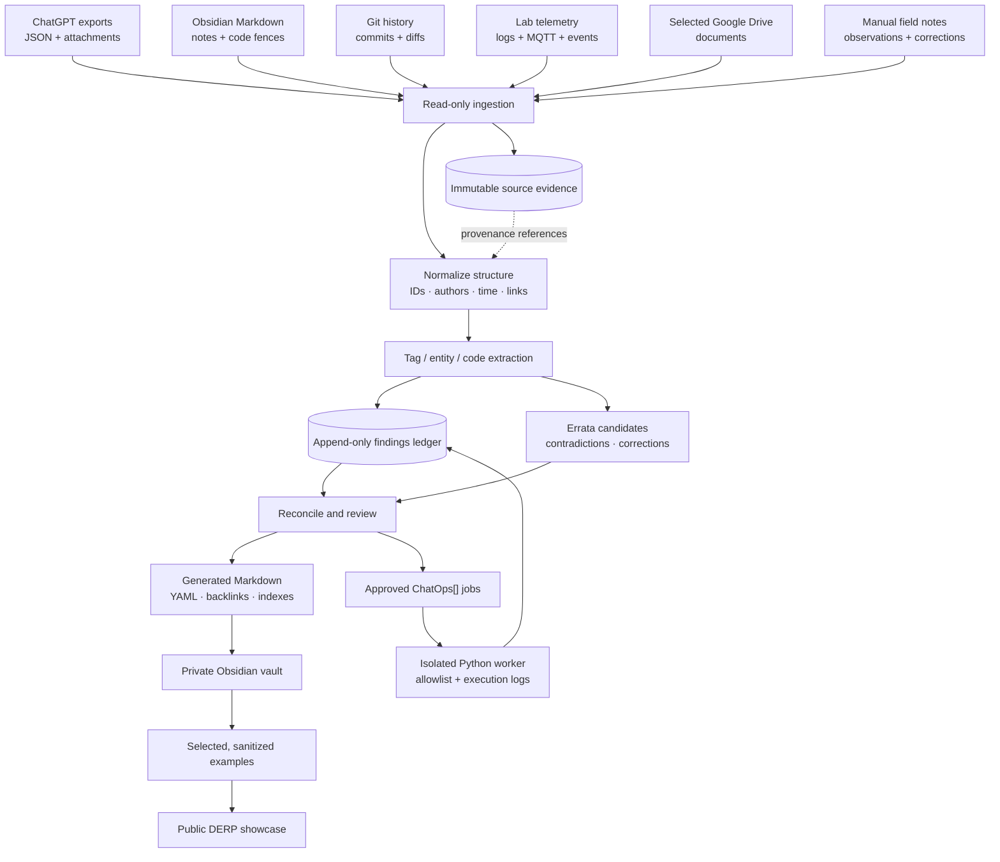

# Derived-Entropic-Rememory-Protocol (DERP)

**A Markdown-first research notebook with evidence, version history, and optional automation.**

DERP is an experiment in keeping technical notes, source records, hypotheses, corrections, and project decisions connected and reusable. [Obsidian](https://obsidian.md/) provides the workspace; Git provides version history; optional ingestion workers turn selected evidence into navigable notes.

> **This repository is a public demonstration of the pipeline, not the private research vault.** Keep personal notes, transcripts, credentials, and source archives in separate private storage. Historical public commits may contain earlier unedited material; see the [Publication Policy](./PUBLICATION-POLICY.md).

## Getting started: choose your level

### 1. Beginner — Local Obsidian + Gemini-accessible folder

**Start writing. No automation required.**

1. [Download and install Obsidian](https://obsidian.md/download).
2. Create a vault on fast, reliable local storage, ideally an SSD.
3. Organize your Markdown notes with folders and `[[wiki-links]]`. Keep the original vault local.
4. Create a separate Google Drive folder for notes you deliberately want Gemini to access.
5. Connect Gemini to Google Drive where your account supports it, grant the necessary access, and copy only selected notes into that folder. **A Drive folder alone does not give Gemini access.** Check supported file formats and account permissions.

**You get:** a local notebook and a selectively shared AI-accessible workspace.

### 2. Intermediate — Add Git for versioning and a private remote

**Do Level 1, then preserve your changes.**

1. Initialize a Git repository for the notes you intend to version.
2. Create a **private** repository on [GitHub](https://github.com/) or another Git host and connect it as the remote.
3. Add a `.gitignore` for caches, secrets, raw exports, machine-specific settings, and other files that do not belong in Git.
4. Commit meaningful changes, push to your remote, and pull before working from another machine.
5. Publish sanitized examples separately if you want a public showcase.

**You get:** file history, remote availability, and the ability to recover earlier versions. Git is not automatic real-time sync, and a private remote is not a substitute for an independent backup.

### 3. Advanced — Add ChatOps[] and a Python ingestion worker

**Do Levels 1 and 2, then automate the repeatable parts.**

Treat **ChatOps[]** as an operations interface, not an unrestricted command interpreter. A chat assistant can propose a job; a Python worker validates and runs an approved operation and records what happened.

Useful worker capabilities include:

- Read Markdown, JSON exports, logs, Git histories, and selected connected documents.
- Extract fenced `python` blocks **as text** for review, linting, and reproducible tests.
- Identify entities, aliases, references, timestamps, and candidate Obsidian tags.
- Produce a source-linked extraction ledger, an Errata review queue, and generated Markdown notes.
- Run allowlisted headless diagnostics or jobs in an isolated environment with explicit authorization and execution logs.

**Keep code extraction separate from code execution.** Markdown from conversations, third parties, and repositories is untrusted input. Do not auto-execute discovered code, including network callbacks, shells, or reverse-shell examples. For intentional lab demonstrations, use a separately approved, isolated execution path with bounded permissions and no default access to the host.

**You get:** a reproducible, evidence-driven pipeline where notes can instruct *reviewed workflows* without turning every note into an executable program.

## Multiple ingestion pathways

The point is not to force every source through one format. Each source retains its identity and provenance, while derived artifacts become searchable and cross-linked.

**Source evidence is not silently rewritten.** A mention is not proof of deployment; a suggestion is not a completed change; and an Errata candidate is not a confirmed correction. Derived notes should point to the source record that supports them.

## Explore this public demonstration

- [**Hey, check this out: reconcile your old GPT stuff**](./Reconciliation/README.md) — turn exported chats into an evidence-linked private Obsidian archive and resumable AI handoffs.
- [Delegated Etheral Remote Protocol](./Projects/Delegated-Etheral-Remote-Protocol/README.md) — remote note capture and cross-model review.
- [Container Security Labs](./Projects/Container-Security-Labs/README.md) — container boundaries and documented lab work.
- [Matryoshka Containment Unit](./Projects/Container-Security-Labs/Matryoshka-Containment-Unit-Checkpoint-2026-11-23.md) — evidence-first case study.
- [Peanut Butter and Jelly Machine](./Projects/Peanut-Butter-and-Jelly-Machine/README.md) — reusable workflow thought experiment.
- [Technical Portfolio](./Projects/Technical-Portfolio/README.md) — public, provenance-driven portfolio construction and build journal.
- [Research backlog](./research/DERP-Research-Backlog.md) — experiments and unresolved questions.
- [Archive strategy](./research/Conversation-Archive-Strategy.md) — source provenance and derived records.

## The More You Know

[**The More You Know**](https://en.wikipedia.org/wiki/The_More_You_Know) — knowing how a tool works is useful; knowing what *not* to automate is just as important.

DERP favors **evidence → extraction → review → reproducible action** over blind execution. Start simple. Add capabilities when you can explain and validate them.

## Publication and attribution

The public repository contains selected documentation and experiments, not the full research history. See the [Publication Policy](./PUBLICATION-POLICY.md) and [editorial change record](./research/Publication-Cleanup-2026-11-23.md) for disclosure, source handling, and prior cleanup.
