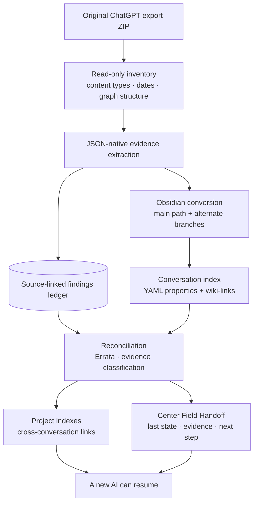

# Hey, check this out: reconcile your old GPT stuff

**What if all those old ChatGPT conversations could become a useful, navigable Obsidian knowledge base—instead of a pile of forgotten chats?**

That's the experiment behind DERP's historical reconciliation workflow. Preserve the original record, extract what was discussed, separate observations from guesses, and make it possible for a different AI to pick up the work with no previous chat context.

This is a **public walkthrough of the method**, not a release of anyone's private conversations.

## Try the workflow

1. **Export your ChatGPT data.** Keep the original export ZIP untouched. Record its filename, creation date, and SHA-256 digest.
2. **Make a private Obsidian vault.** Work on fast local storage. Do **not** use this public repository as your personal transcript destination.
3. **Inventory before importing.** Count conversations and message nodes, inspect content types, and choose a documented time cutoff.
4. **Preserve the conversation graph.** Chat history can contain alternate responses and branches. Preserve message IDs, parent IDs, authors, timestamps, and the active path; don't just sort messages by date and pretend they form one dialogue.
5. **Normalize and extract.** Read the exported JSON; build source-linked, machine-readable findings. Extract hostnames, concepts, projects, code examples, and possible corrections as **candidates**, not established facts.
6. **Generate Obsidian notes.** Convert the main dialogue and alternate branches into readable Markdown with YAML properties, indexes, and links to the preserved evidence.
7. **Reconcile.** Review contradictions and corrections. Keep the old claims, note their dates, and append sourced corrections.
8. **Write a handoff checkpoint.** Can another AI read the result and continue the project without redoing your investigation?

**Notebooks are presentation. Source evidence is the record.** Never run Python or shell commands extracted from a chat or Markdown file automatically.

## COPY THIS: a working starter

The [public starter worker](./derp_starter.py) is deliberately small: **Python standard library only**, read-only access to the original ZIP, and no need to upload private conversations. It writes a conversation metadata index, a CSV, and a manifest into a **new** output directory. It does **not** claim to be the full v0.3 dialogue converter.

### 1. Download the script (PowerShell)

Create a private working directory on a local disk and download the audited-in-repository example:

```powershell
$Work = "H:\\DERP-Private"
New-Item -ItemType Directory -Force -Path $Work | Out-Null

$Worker = Join-Path $Work "derp_starter.py"
$Url = "https://raw.githubusercontent.com/craigmcdaniel/Derived-Entropic-Rememory-Protocol/main/Reconciliation/derp_starter.py"

Invoke-WebRequest -Uri $Url -OutFile $Worker
Get-FileHash -Algorithm SHA256 -LiteralPath $Worker
```

Change `$Work` if your private storage is not on `H:`. Read the worker before running it.

### 2. Run the indexer on your own export (PowerShell)

```powershell
$Zip = "G:\\path-to-your-chatgpt-export.zip"
$Output = Join-Path $Work "obsidian-index-v01"

if (-not (Test-Path -LiteralPath $Zip)) {
    Write-Host "ERROR: Export ZIP not found"
    return
}

if (Test-Path -LiteralPath $Output) {
    Write-Host "ERROR: Output exists; select a new directory"
    return
}

py -3 $Worker $Zip $Output --cutoff "2025-10-01T00:00:00-04:00"
```

Choose your own cutoff. The example is based on DERP's historical pilot. The worker refuses to overwrite an existing output folder.

### 3. Open the result in Obsidian

```powershell
Invoke-Item -LiteralPath (Join-Path $Output "INDEX.md")
```

To use it as a vault, open Obsidian → **Manage vaults** → **Open folder as vault** and select the `obsidian-index-v01` directory. This initial index is a navigable conversation list; the full dialogue-to-Markdown converter is a separate, more advanced step.

### 4. Record reconciliation decisions (Markdown example)

Create a note in a **private** vault under `Reconciliation/Errata/`:

```markdown
---
type: errata
status: pending-review
source: chatgpt-export
---

# Example correction

- Claim: A service was running on HOST-A.
- Source conversation ID: REPLACE_WITH_ID
- Source message node ID: REPLACE_WITH_NODE_ID
- Observed at: REPLACE_WITH_TIMESTAMP
- Later correction: The service was only proposed, not installed.
- Evidence for correction: REPLACE_WITH_CORRECTING_NODE_ID
- Classification: proposed
- Verification: pending
- Next action: Review both messages before updating project notes.
```

**Important:** this template is an illustrative example, not a real claim from DERP's private archive. Do not silently promote a text match to a verified operational fact.

## How the pieces fit



## Checkpoints from the DERP prototype

The prototype used an October 1, 2025 cutoff and reported the following *historical run outputs*. They illustrate the workflow; they are not a public source dump or independently audited infrastructure inventory.

| Stage | Recorded result |
|---|---|
| Export inventory | 153 conversations in the source export |
| Qualifying conversations | 122 |
| Qualifying message nodes | 71,489 |
| JSON-native extraction v0.2 | 53,590 text-bearing messages scanned |
| Unverified infrastructure matches | 66,407 findings |
| Obsidian conversion v0.3 | 762 generated Markdown parts |
| Obsidian conversion v0.3 | 54,913 main-path messages and 560 alternate-path messages reported |

The numbers measure processing outputs, **not** accuracy of extracted claims. Loopback IP addresses, suggestions, quoted command examples, and failed configurations all require interpretation.

## Reconciliation classifications

| Label | Interpretation |
|---|---|
| **Observed** | Specific direct evidence supports the claim or event |
| **Historical** | Supported at a particular point in time, not necessarily now |
| **Proposed** | Discussed or planned, with no implementation confirmation |
| **Unverified** | Mention detected or claim made, pending corroboration |
| **Corrected** | A later evidence-linked correction supersedes an earlier assertion |

A claim should retain source ID, message/node ID, author, event time, processing version, and its supporting excerpt. Keep the original statement even when it turns out to be wrong.

## Center Field Handoff Rule

> Document enough evidence, decisions, failures, corrections, environment details, and next actions that a new AI can pick up the ball and mitt in center field and continue immediately.

A useful handoff gives a newcomer the **objective**, **last known state**, **what was tried**, **what failed**, **what was confirmed**, **what remains uncertain**, and **the next concrete step**. It is not merely a transcript summary.

## Folder layout to aim for

```text
Private-Archive/
├── ingestion-engine/
│   ├── infrastructure-v0.2/
│   │   ├── evidence.jsonl
│   │   └── manifest.json
│   └── workers/
└── obsidian-v0.3/
    ├── INDEX.md
    ├── MANIFEST.json
    ├── Evidence/
    ├── Conversations/
    └── Reconciliation/
        ├── Evidence/
        ├── Errata/
        ├── Project-Indexes/
        └── Handoffs/
```

This is an illustrative structure, not a claim that every reconciliation subfolder has been populated.

## Why this is worth trying

Long technical chats contain decisions and negative results that short summaries throw away. A historical archive preserves the original chronology; reconciliation identifies which parts are worth trusting; an Obsidian index makes them findable; and a handoff checkpoint turns that history into actionable context for a future AI.

**Start with a single conversation. Validate its branches and links. Then scale the same reproducible pipeline to your archive.**

See also the [conversation archive strategy](../research/Conversation-Archive-Strategy.md), [DERP research backlog](../research/DERP-Research-Backlog.md), and [publication policy](../PUBLICATION-POLICY.md).

**The More You Know:** [The More You Know](https://en.wikipedia.org/wiki/The_More_You_Know).
